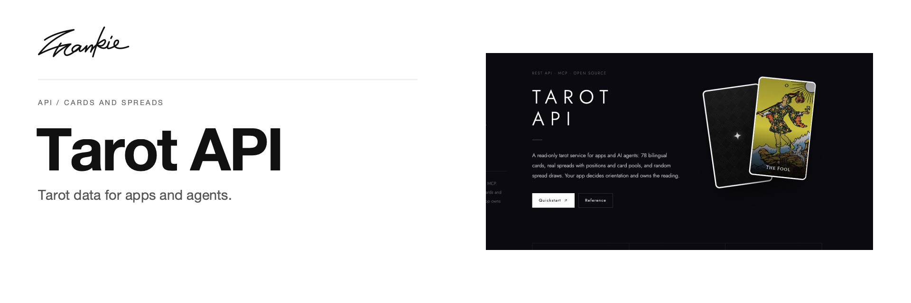

# Frankie Tarot API

Read-only tarot data for applications and agents, with bilingual cards, spread definitions and optional draws.

[API docs](https://tarot-api.songhai.site/) · [OpenAPI](https://tarot-api.songhai.site/openapi.json) · [Agent MCP](https://tarot-api.songhai.site/mcp/agent) · [Guide](docs/guide.md) · [Run locally](#run-locally)

## What it does

- Retrieve 78 bilingual cards and 11 spread definitions over REST.
- Connect agents through the UI-free MCP service.
- Draw distinct cards or a spread when the user explicitly delegates drawing.

## Run locally

Use npm to install dependencies and start the local service:

```sh
npm ci
npm run api
```

REST and MCP are served at http://127.0.0.1:3001. Use `npm run dev` to edit the documentation site.

## Before you start

The public service needs no API key. The calling app owns orientation and interpretation. A random draw is a new sample, so an uncertain request must not be retried as if it were the same reading. Full contracts and examples are in the project guide.

## For developers

```sh
npm run api:test
npm run typecheck
npm run build
```

Contract maintenance, smoke checks and deployment instructions remain in the project guide.

[Project guide](docs/guide.md) · [Artwork](docs/readme/README.md)

---

Made by [Songhai Fan](https://github.com/SonghaiFan) · A Frankie project · [License notes](docs/guide.md#license)
