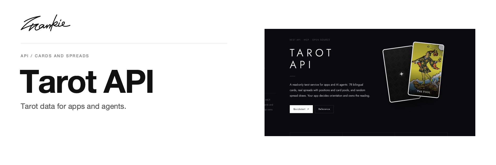

# Frankie Tarot API

[English](README.md) · [简体中文](README.zh-CN.md)

面向应用与智能体的只读塔罗数据服务，提供双语牌义、牌阵定义与可选的抽牌功能。

[API 文档](https://tarot-api.songhai.site/) · [OpenAPI](https://tarot-api.songhai.site/openapi.json) · [智能体 MCP](https://tarot-api.songhai.site/mcp/agent) · [项目指南](docs/guide.md) · [本地运行](#本地运行)

## 可以做什么

- 通过 REST 获取 78 张双语卡牌与 11 种牌阵定义。
- 通过不带 UI 的 MCP 服务连接智能体。
- 在用户明确委托抽牌时，抽取不重复的卡牌或完整牌阵。

## 本地运行

使用 npm 安装依赖并启动本地服务：

```sh
npm ci
npm run api
```

REST 与 MCP 服务运行于 http://127.0.0.1:3001。编辑文档站点时使用 `npm run dev`。

## 开始之前

公共服务无需 API key。调用方应用管理正逆位与解读。随机抽牌每次都会产生新样本，因此请求结果不确定时，不能将重试视为同一次解读。完整约定与示例见项目指南。

## 开发说明

```sh
npm run api:test
npm run typecheck
npm run build
```

接口约定维护、冒烟检查与部署说明见项目指南。

[项目指南](docs/guide.md) · [Banner 维护](docs/readme/README.md)

---

由 [Songhai Fan](https://github.com/SonghaiFan) 制作 · Frankie 系列项目 · [许可说明](docs/guide.md#license)
