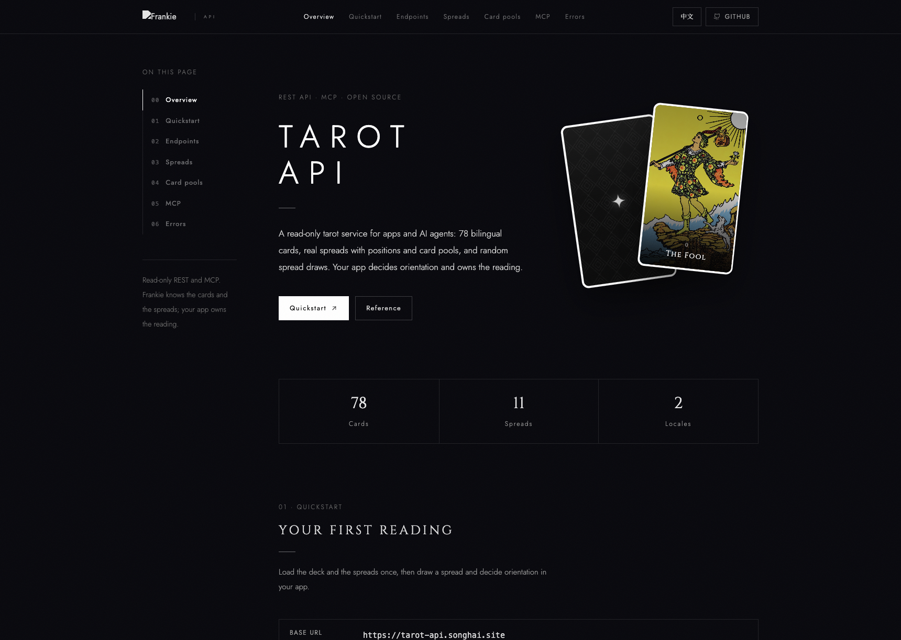

<h1 align="center"><picture><source media="(prefers-color-scheme: dark)" srcset=".github/brand/icon-dark.svg"></picture><br>Frankie Tarot API</h1>

<p align="center"><b>面向应用与智能体的只读塔罗数据服务，提供双语牌义、牌阵定义与可选的抽牌功能。</b></p>

<p align="center"><a href="https://songhaifan.github.io/frankie-tarot-api/zh/">项目介绍</a> · <a href="https://tarot-api.songhai.site/">API 文档</a> · <a href="docs/guide.md">使用指南</a> · <a href="README.md">English</a></p>

<p align="center"></p>

## 可以做什么

- 通过 REST 获取 78 张双语卡牌与 11 种牌阵定义。
- 通过不带 UI 的 MCP 服务连接智能体。
- 在用户明确委托抽牌时，抽取不重复的卡牌或完整牌阵。

## 本地运行

使用 npm 安装依赖并启动本地服务：

```sh
npm ci
npm run api
```

REST 与 MCP 服务运行于 http://127.0.0.1:3001。编辑文档站点时使用 `npm run dev`。

## 开始之前

公共服务无需 API key。调用方应用管理正逆位与解读。随机抽牌每次都会产生新样本，因此请求结果不确定时，不能将重试视为同一次解读。完整约定与示例见项目指南。

## 开发说明

```sh
npm run api:test
npm run typecheck
npm run build
```

接口约定维护、冒烟检查与部署说明见项目指南。

[项目指南](docs/guide.md) · [Banner 维护](docs/readme/README.md)

---

<!-- series-footer:start -->

<p align="center">
<a href="https://songhaifan.github.io/frankie-brain/"></a> &nbsp; <a href="https://songhaifan.github.io/frankie-brain-ios/"></a> &nbsp; <a href="https://songhaifan.github.io/frankie-cards/"></a> &nbsp; <a href="https://songhaifan.github.io/frankie-dictionary/"></a> &nbsp; <a href="https://songhaifan.github.io/frankie-generative-art/"></a> &nbsp; <a href="https://songhaifan.github.io/frankie-goal/"></a> &nbsp; <a href="https://songhaifan.github.io/frankie-guitar/"></a> &nbsp; <a href="https://songhaifan.github.io/frankie-list/"></a> &nbsp; <a href="https://songhaifan.github.io/frankie-mbti/"></a> &nbsp; <a href="https://songhaifan.github.io/frankie-onitama/"></a> &nbsp; <a href="https://songhaifan.github.io/frankie-poker/"></a> &nbsp; <a href="https://songhaifan.github.io/frankie-stocks/"></a> &nbsp; <a href="https://songhaifan.github.io/frankie-tarot/"></a> &nbsp; <a href="https://songhaifan.github.io/frankie-tarot-api/"></a> &nbsp; <a href="https://songhaifan.github.io/frankie-werewolf/"></a>
</p>

<p align="center"><a href="https://songhaifan.github.io/frankie-owspace-api/">OWSPACE Archive</a></p>

<p align="center"><sub>Frankie series · Made by <a href="https://github.com/SonghaiFan">Songhai Fan</a></sub></p>

<!-- series-footer:end -->

<p align="right"><picture><source media="(prefers-color-scheme: dark)" srcset=".github/brand/signature-dark.svg"></picture></p>
